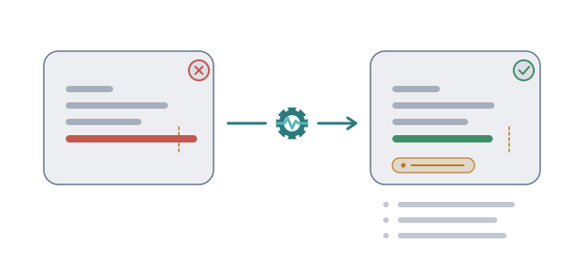

# Tool doctor

[](https://github.com/DeepNeuralNerd/dsh-tool-doctor/releases) [](https://github.com/DeepNeuralNerd/dsh-tool-doctor/releases) [](LICENSE)

**Fewer failed tool calls. Less backtracking.**

An AI assistant can understand your task and still stumble over a tool request: a line number past the end of a file, a number supplied as text, or an edit that misses because its spacing changed. Tool doctor catches **supported, mechanical mistakes** in DeepSeek Harness (DSH), corrects the request or retries a recoverable error, and records what happened. You spend less time watching the assistant repeat a call it could have fixed.

For example, if a tool rejects `limit: 5000` and reports a maximum of `2000`, Tool doctor can retry with `limit: 2000`. If that retry fails, the original error remains available to the assistant. The dashboard distinguishes a successful repair from an attempted repair, an ordinary failure, and a call merely recognized in text.



## Why use it

- **Keep work moving.** Repair recognized argument mistakes before dispatch and recover from selected errors after dispatch, without asking the model to work out every mechanical correction itself.
- **See what actually happened.** Review bounded argument previews, repair outcomes, recurring failures, and estimated token savings in the Plugin Manager dashboard. Recognizing a call in text does not count as a successful repair.
- **Stay in control.** Switch rules individually, inspect a rule's recent activity, try shadow mode to record potential pre-dispatch repairs while sending the original arguments, or disable the plugin. A circuit breaker pauses recovery classes that repeatedly fail.

Tool doctor is useful if you are new to DSH and want fewer avoidable interruptions. If you build long coding workflows, its schema-aware repairs, bounded retries, and local diagnostics also give you a way to inspect where tool calls go wrong.

## What it does

- **Repairs arguments before a call runs.** Supported cases include wrapped or stringified argument objects, values that conflict with an available tool schema, parameters sent under a well-known wrong name (renamed only when the tool's own schema confirms it), quoted paths (straight and curly), some path and range mistakes, and common `run_code` formatting errors.
- **Recovers from selected tool errors.** Depending on the error and available tools, it can retry a range request at the reported bound, refresh file observation, retry an edit with a whitespace-equivalent anchor, correct an unambiguous tool name, or list a directory sent to a file reader.
- **Recognizes in-text tool calls.** When the model emits supported call markup as text, the plugin can promote it to a structured tool call. Promotion is recorded separately from execution success.
- **Provides diagnostics and controls.** The dashboard shows recent calls, repair outcomes, recurring error patterns, rule switches, and editable model guidance. A circuit breaker temporarily pauses recovery classes that repeatedly fail.

The plugin handles mechanical patterns. It cannot infer a model's intent, make a missing file exist, or resolve every permission, tool, or command failure. A successful call after an argument rewrite is counted as a repair outcome; it does not prove that the original call would have failed. Token savings shown in the dashboard are estimates, not measured billing reductions.

## Use it in DSH

Install the published GitHub repository into your DSH web profile:

```bash
dsh plugin --profile web add github:DeepNeuralNerd/dsh-tool-doctor
```

Restart DSH after installation so the host loads the plugin. Then open **Settings → Plugins → Installed → Tool doctor** to review activity and adjust rules. The plugin's repairs are enabled by default; you can switch individual rules off in its dashboard.

Rules are enabled by default. The dashboard can turn them on or off without a restart. Rule overrides are saved under the DSH home directory. Model guidance edits take effect immediately in the running process but return to the factory default after a plugin restart.

The dashboard's data comes from local files under `DSH_HOME` (or `~/.dsh` when that variable is unset): `tool-doctor-events.jsonl` for detailed diagnostic events and `tool-doctor-summary.json` for counters. Argument previews are bounded and redact common secret forms. Review exported records before sharing them because errors and paths can still contain sensitive information. The plugin does not add its own telemetry service.

## Dashboard API

The plugin registers these routes under `/plugin-api/tool-doctor/`:

| Route | Method | Purpose |
| --- | --- | --- |
| `stats` | GET | Counters, categories, and recent records |
| `candidates` | GET | Recurring unresolved error patterns |
| `config` | GET, POST | Read or update rule switches |
| `guidance` | GET, PUT | Read or update model guidance |
| `guidance/reset` | POST | Restore factory guidance |
| `reset` | POST | Clear diagnostic records and counters |

## Development and verification

```bash
npm run check
```

This runs TypeScript checking, the automated tests, and the build. The build emits `lib/index.js` for the host and `lib/client.js` for the dashboard. Tests cover the repair mechanics, pipeline, dashboard, and adapter contract with a simulated Cordis host. Check behavior against the installed DSH version before relying on a repair in a production workflow.

## License

MIT. See [LICENSE](LICENSE).

